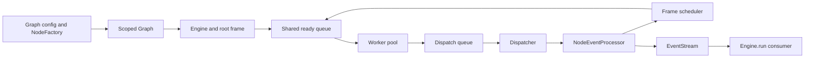

<!-- knowledge
last_checked: "2026-11-18T07:19:21Z"
-->
# Architecture

This navigation map describes the current implementation, not historical design
decisions.
Contributor commands and contribution rules live in [CONTRIBUTING.md](CONTRIBUTING.md).

## Public entry points

Graphon is an embeddable Python workflow engine. The host application supplies
workflow configuration, inputs, integration adapters, and any persistence.
The top-level `graphon` package does not re-export its primary classes; import
them from the packages below.

| Surface | Entry point | Evidence |
| --- | --- | --- |
| YAML import and inspection | `graphon.dsl.inspect`, `graphon.dsl.loads` | [Importer](src/graphon/dsl/importer.py), [DSL tests](tests/dsl/) |
| Graph construction | `graphon.graph.Graph`, `GraphBuilder`, `NodeFactory` | [Graph implementation](src/graphon/graph/graph.py), [graph tests](tests/graph/test_graph.py) |
| Execution | `graphon.engine.Engine` | [Engine](src/graphon/engine/engine.py), [workflow tests](tests/workflows/test_full_engine_events.py) |
| Execution setup and state | `graphon.runtime.RuntimeState`, `VariablePool`, `InitParams` | [Runtime exports](src/graphon/runtime/__init__.py), [runtime tests](tests/runtime/) |
| Integration contracts | `graphon.protocols` | [Protocol exports](src/graphon/protocols/__init__.py), [export tests](tests/test_protocols_exports.py) |

The [Python example](examples/slim_llm/code.py) constructs nodes and an engine
directly. The [DSL example](examples/slim_llm/dsl.py) uses `loads()`, which builds
the variable pool, runtime state, node factory, graph, and engine. Built-in node
availability and default DSL support are separate concerns: inspect the
[DSL factory](src/graphon/dsl/node_factory.py) for its supported node types.

## Import boundaries

The [Import Linter configuration](pyproject.toml) is the source of truth for
allowed package dependencies. [Layer regression tests](tests/test_import_layers.py)
exercise enforcement in CI.

The public runtime package can restore snapshots without importing the engine.
Importing `graphon.protocols` does not register built-in nodes; importing a concrete
node implementation registers its type and version. These guarantees are enforced by
[runtime import tests](tests/runtime/test_runtime_imports.py) and
[public-contract import tests](tests/test_protocols_exports.py). Use the public
runtime paths for new integrations; engine queue aliases exist for compatibility.

## Execution flow

1. [Graph.init](src/graphon/graph/graph.py) turns input configuration into a
   scoped executable graph. `Graph.new()` supplies the builder for directly
   instantiated nodes; see the [Python example](examples/slim_llm/code.py).
2. [Engine](src/graphon/engine/engine.py) binds a root frame, command processor,
   event stream, fixed worker pool, and dispatcher. Calling `run()` starts or
   resumes execution and yields graph and frame lifecycle events, committed
   variable observations, and processed node and traversal events.
3. [Scheduler](src/graphon/engine/scheduler.py) queues frame-qualified `StartTask`
   values. [Workers](src/graphon/engine/worker/worker.py) bind execution IDs,
   execute node generators inside [layer task contexts](src/graphon/engine/layer/README.md),
   and queue results.
4. [Node.run](src/graphon/nodes/base/node.py) wraps `_run()`, emits the start event,
   converts node payloads into engine events, and converts execution exceptions
   into failed-node events. Node implementations live in [nodes](src/graphon/nodes/).
5. [Dispatcher](src/graphon/engine/dispatcher.py) serializes result processing,
   external commands, and completion detection. Its
   [event processor](src/graphon/engine/event/processor.py) stores outputs,
   applies failure/retry policies, updates scheduling, and publishes events.
6. [EventStream](src/graphon/engine/event/stream.py) buffers events for the caller
   and notifies layers. `Engine.run()` emits terminal status and stops execution
   resources. A failed graph emits `GraphRunFailedEvent` and raises its error.

Response presentation is a consumer concern. `Engine.run()` yields raw engine
events; hosts use [filter_engine_events](src/graphon/engine/filter/chain.py) with
[ResponseStreamFilter](src/graphon/engine/filter/builtin/response_stream/filter.py)
for response selection, template assembly, buffering, and presentation order.
Producer chunks remain immediate, including across parallel container items. [Raw event tests](tests/engine/test_raw_engine_events.py) · [Filter tests](tests/engine/test_event_filters.py)
When a polling or ordinary LLM call supplies no text deltas, its final `[node_id, "text"]` chunk carries the node's `text` output.
An attempt that sent any text delta, even an empty one, closes with an empty final chunk. [LLM node](src/graphon/nodes/llm/node.py) · [LLM tests](tests/nodes/llm/test_node.py)

## Raw frame observations

By default, the engine emits the following observations so consumers can read them even after a child frame has been removed. [Frame events](src/graphon/engine_events/frame.py) · [Node events](src/graphon/engine_events/node.py)

| Event | Meaning |
| --- | --- |
| `FrameStartedEvent` | A detached, typed variable baseline and reserved node execution IDs, published after setup and before body scheduling. Child frames also identify their parent and owning container invocation. |
| `FrameVariablesUpdatedEvent` | Detached replacements at the written selectors, published after successful commits. Empty and `None` values are retained; partial failures report only writes that succeeded. |
| `NodeRunResponseReadEvent` | A built-in Answer or End with explicit `[node_id, "text"]` lookups produces this observation before its success event. Each lookup has a template position and carries Answer's rendered Markdown, End's detached segment, or `None` for a missing value. |
| `FrameFinishedEvent` | The frame has emitted its last node, traversal, and variable observations, with a succeeded, failed, or aborted outcome. Child completion is published before registry removal. |

Set `Engine(..., emit_frame_events=False)` to skip these events and their detached value copies for both event consumers and layers while execution and variable commits continue.
This engine option is not persisted; supply it again when rebuilding from a snapshot.

[FrameRegistry](src/graphon/engine/frame.py) publishes commits for node outputs
and handled-failure defaults, variable requests, Loop initialization, Loop and
Iteration ancestor write-back, and external commands. Every frame sharing an
updated pool receives the observation; private Iteration writes do not produce
ancestor commits. Output commits precede dependent traversal; existing node
request/result events remain available and must not be applied again when
maintaining a view from commit events.

[NodeEvent](src/graphon/engine_events/base.py) carries `frame_id` and
`retry_index`; `id` remains the reserved execution ID across retries.
`NodeRunRetryEvent.retry_index` identifies the next attempt.
[EngineEventFilterContext.from_engine](src/graphon/engine/filter/protocol.py)
sets `run_id` to the persisted root entry execution ID, so it survives
pause/restore and distinguishes separate runs with the same `workflow_id`.

Pause leaves unfinished frames open. Resume publishes new baselines with the
resumption reason and existing execution IDs before resumed body events.
Only the resumed root baseline supplies `completed_node_ids`.
It includes nodes marked `TAKEN` at the pause after excluding queued or deferred starts and suspended containers.
This distinguishes a completed leaf response from one that was already scheduled. [Frame registry](src/graphon/engine/frame.py) · [Paired resume tests](tests/engine/test_llm_reply_resume.py)
[Persisted container state](src/graphon/runtime/container_state.py) preserves pending frame failures across pause and snapshot restore even when frame events are disabled.
Terminal failure or abort closes each remaining frame once, before the graph's terminal event.
An `Exception` thrown into `Engine.run()` during execution or at the paused event
follows the same failure ordering; continued consumption re-raises the exception.

Root has no owning invocation. Custom containers may omit optional item index
and root metadata. See the
[frame observation tests](tests/engine/test_frame_observations.py) for baselines,
commits, detached values, and raw chunk delivery, and the
[frame failure tests](tests/engine/test_frame_failures.py) for pause/restore and
consumer exceptions.

Baselines, commits, and response reads can carry full variable values.
`ResponseStreamFilter` consumes these observations and forwards ordinary node results, including Answer's `answer` and `files` outputs.
The read event shares the response's frame, execution ID, and retry index and preserves repeated lookups and End fields with the same output name. [Response read tests](tests/engine/test_response_read_observations.py)

## Response sessions

[ResponseStreamFilter](src/graphon/engine/filter/builtin/response_stream/filter.py)
owns independent root and child [frame sessions](src/graphon/engine/filter/builtin/response_stream/frame_session.py).
Root templates use the existing Python node interfaces. Child Answer and End
templates come from [retained definitions](src/graphon/engine/filter/builtin/response_stream/frame_graph.py),
without constructing nodes or calling factories. Frame starts activate initially
eligible templates. Fresh sessions maintain [reachability](src/graphon/engine/filter/builtin/response_stream/reachability.py)
per response through nonblocking edges and consumed traversal events. Branches,
containers, responses, and nodes that block referenced variables gate their
outgoing edges until taken; a blocking edge skipped before it is taken remains
rejected. Shared suffixes are visited once per response instead of expanding into
complete paths. Each native frame session owns the first consumed taken/skipped
decision for each edge; response caches read that map while keeping their own
selector-dependent blocking edges. Observed skips used for template selection
remain separate from these first decisions. Activation does not read live edge
states. A reserved execution ID alone does not make a reply reachable. Custom
frames without enough declarative context get no response session; ordinary node
and completion events still pass through.

Keep `emit_frame_events=True` when using a context from `from_engine()`: the
filter waits for the root baseline before resolving values. Each observed frame keeps a detached value pool and applies
committed replacements in publication order, including when events are consumed
after engine frames have been removed. Result and variable-request events do not
apply values again. Direct contexts without `run_id` retain the legacy manual
event-stream behavior until a frame baseline is supplied.

Native frames advertise `observes_response_reads` in their baseline.
A built-in Answer or End that references a whole LLM result supplies the value it read at each template position, including when the model was skipped or inherited.
A queued reply keeps those reads across later edits.
The filter renders files in End's captured segments with its file adapter.
A missing value contributes no text, though a local model that can still run may stream deltas at that position.
Tokens, literals, and ordinary variables can stream as soon as earlier template positions allow.
Ordinary variables and older streams without the baseline flag use the committed pool for value lookups. [Template assembly](src/graphon/engine/filter/builtin/response_stream/template_stream.py) · [Live token tests](tests/engine/test_llm_answer_streaming.py) · [Queued reply tests](tests/engine/test_llm_reply_values.py)

Root responses share one cursor per streamed selector, including across repeated references.
If a retry returns a whole result after the root cursor consumed text from the failed attempt, an empty marker closes that stream.
If the cursor consumed no text, the response can display the value it read.
In a child frame, each template occurrence keeps a cursor for its source execution and attempt.
A committed replacement can supply later occurrences.
A retry rebuilds a child reply still waiting for display and keeps unrelated values it already read.
Once a child reply displays text from a source, that occurrence stays on the same attempt.
In either scope a failed attempt that emitted only empty text deltas leaves the reference available for a retry, even after the reply displayed its prefix.
Successful and handled failure results close unfinished child sources.
Child Answer chunks use the reserved Answer execution ID and `[answer_node_id, "answer"]` selector, with one final marker after the template, including for empty replies.

The filter's [reply order](src/graphon/engine/filter/builtin/response_stream/reply_order.py)
reserves container groups at node start, before their first child reply. Frames
with item indices drain in numeric order within an invocation; a frame keeps its
place until it and its descendants finish and their replies drain. The current
reply streams live from prefix through suffix without interruption by descendants
or siblings.
The filter keeps consuming raw events while later replies wait. Containers without
descendant Answer or End definitions do not delay independent root responses.

Failed or aborted frames close displayed child Answers and discard their remaining
templates. After a failed item, pending siblings wait for container continuation or
a successful or handled result; a failed container discards them. Graph success,
including partial success, drains eligible replies before its terminal event. Graph
failure or abort discards pending replies before `flush()` is needed. Completed
frames release captured values and source buffers; queued text is released as it
drains or is discarded.

Version 3.1 root filter checkpoints store values a response read at LLM references that the filter has yet to display.
They record each read's template position alongside stream cursors, execution IDs, retry indices, and edge decisions.
Restore the runtime and filter checkpoints from the same drained pause.
A response scheduled to run after resumption supplies fresh reads when it executes.
Versions 1.0 through 3.0 can lack a completed reply's reads.
When its remaining text cannot be reconstructed, the filter follows the old cursor, including any omission from an empty final marker.
A root marker consumed before the pause stays consumed across repeated references. [Root codec](src/graphon/engine/filter/builtin/response_stream/v3.py) · [Paired LLM pause tests](tests/engine/test_llm_reply_resume.py) · [Retry and marker tests](tests/nodes/llm/test_node.py)
Restoring v1 or v2 retains its residual blocking paths explicitly in v3; v1
migration also discards child response state. Native decisions and legacy paths
are mutually exclusive runtime states. The flat v3 wire format rejects legacy
paths combined with nonempty native decision lists. Earlier v3 inputs with an
edge in both taken and rejected lists remain readable: rejection represents a
first skip and wins during restoration. Sessions started from an initial frame
baseline additionally record observed skipped edges, so resumed templates
do not consult future live node states. Snapshots without this optional metadata
retain the paired graph's skip lookup. See the [paired pause checkpoints](tests/engine/test_response_stream_pause.py)
for old runtime/filter snapshots resumed through HITL and host pause commands,
the [response filter tests](tests/engine/test_response_stream_filter.py)
for native and legacy restoration, [traversal and selector tests](tests/engine/test_response_stream_filter_performance.py)
for selector-dependent and live-state behavior, and [gating regressions](docs/development.md#response-gating-regressions)
for resource bounds, path equivalence, and ordered output.
After a child frame containing an Answer or End starts, `dumps()` and `loads()`
reject that filter instance's state, including after the frame finishes. Pending
container response reservations are also rejected, including before the first child
frame starts. Resuming a frame in a container with descendant responses is rejected.
Complete child pause/resume and ordering-state serialization remain stage F of
[#356](https://github.com/langgenius/graphon/issues/356).
The [container response tests](tests/engine/test_container_response_streaming.py)
cover sequential Loop/Iteration, source policies, files, and snapshot boundaries;
the [reply ordering tests](tests/engine/test_response_reply_ordering.py) cover parallel
and nested replies, failure outcomes, and root compatibility.

## State and execution invariants

Execution state is owned by frames; shared queues and workflow execution connect
those frames without requiring nested worker pools. File adapters are host
resources owned by the engine, while snapshots contain portable state. These
boundaries let the host rebuild an execution with its own integrations.

[Variable pools](src/graphon/runtime/variable_pool.py) preserve node ownership through copies and serialization for both configured graphs and `Graph.new()` graphs.
Iteration writes host variables already present in the parent pool back to that parent, while keeping inherited node variables private to each round.
Independent workflows with fresh pools have separate ownership even when ancestor or sibling graphs reuse the same node IDs.

The executable contracts below are authoritative for validation, lifecycle, and
compatibility details:

| Concern | Implementation | CI evidence |
| --- | --- | --- |
| Frame state and queue ownership | [Frame](src/graphon/engine/frame.py), [runtime state](src/graphon/runtime/runtime_state/state.py) | [Dispatch](tests/engine/test_dispatch_patterns.py) |
| File adapter binding and isolation | [File runtime](src/graphon/file/runtime.py), [engine](src/graphon/engine/engine.py) | [Execution file isolation](tests/engine/test_file_runtime.py), [file scopes](tests/file/test_runtime.py) |
| Container ownership and factory preflight | [Graph and NodeFactory](src/graphon/graph/graph.py), [scoping](src/graphon/graph/scoping.py), [validation](src/graphon/graph/validation.py) | [Graph scoping and validation](tests/graph/test_graph_scoping.py) |
| Branch joins and readiness | [Scheduler](src/graphon/engine/scheduler.py) | [Scheduling](tests/engine/test_scheduler.py) |
| Container suspension and variable propagation | [Container effects](src/graphon/nodes/container_effects.py), [handlers](src/graphon/engine/container_handler/builtin/) | [Container values](tests/nodes/test_container_effects.py), [cooperative execution](tests/engine/test_cooperative_container_execution.py), [container variable scoping](tests/workflows/test_full_engine_events.py), [Iteration variable ownership](tests/engine/test_iteration_variable_scopes.py) |
| Pause, resume, and snapshot quiescence | [Dispatcher](src/graphon/engine/dispatcher.py), [execution guard](src/graphon/runtime/execution.py) | [Serialization](tests/engine/test_runtime_state_serialization.py) |
| Snapshot versions and migrations | [Snapshot loading](src/graphon/runtime/runtime_state/snapshot.py) | [Runtime snapshots](tests/runtime/test_runtime_state.py), [version isolation](tests/test_snapshot_version_isolation.py) |

[Concrete segment models](src/graphon/variables/segments.py) own fixed
`value_type` tags and value validation. [Factories](src/graphon/variables/factory.py)
infer raw value types or validate explicit declarations; preserve declared types
when transferring values, especially empty arrays and secrets. Assignment uses
[copy_with_value](src/graphon/variables/variables.py) to validate replacements
while retaining variable identity and metadata. See [factory tests](tests/variables/test_factory.py)
and [assignment tests](tests/nodes/variable_assigner/).

Complete `array[any]` snapshots use
[file paths](src/graphon/variables/file_snapshot.py) to distinguish actual
[File](src/graphon/file/models.py) objects from ordinary JSON dictionaries.
Nested models become plain data, while recorded files restore as `File` objects.
Dictionaries containing files require string keys. Exports using `include` or
`exclude` omit this restoration metadata; historical snapshots without it retain
dictionaries as data. See [file snapshot tests](tests/variables/test_file_snapshots.py)
and [container restoration tests](tests/nodes/test_container_effects.py).

[Container values](src/graphon/nodes/container_effects.py) preserve declared
segment types through snapshots and completion. Converting a variable with
`to_segment()` removes its source identity so the parent pool binds completed
outputs to the container's selectors. Storing an existing variable under a new
selector also assigns a new identity; see [variable pool tests](tests/runtime/test_variable_pool.py).
Iteration keeps matching array types when flattening outputs and uses
`array[any]` for mixed array types. See [workflow tests](tests/workflows/test_full_engine_events.py)
for empty, serial, and parallel container behavior.

Stored outputs remain typed; container node-result inputs and Loop/Iteration
presentation events expose plain values. The
[runtime JSON converter](src/graphon/workflow_type_encoder.py) masks typed
secrets using their log representation. Hosts must redact plain values separately,
including exports from [dumps_with_segments](src/graphon/variables/utils.py).
See [container secret tests](tests/nodes/test_container_effects.py) and
[plain value export tests](tests/utils/test_variable_utils.py).

For host rendering, bind the engine's adapter with
[use_workflow_file_runtime](src/graphon/file/runtime.py); use
[EngineEventFilterContext.from_engine](src/graphon/engine/filter/protocol.py) to
wire response filters. Supply host adapters again when rebuilding from snapshots.
See [host file conversion tests](tests/variables/test_workflow_type_encoder.py)
for rendering within that adapter scope.

Persist after fully consuming the run iterator or from a quiescent `on_graph_end`
hook. Hosts must also coordinate direct mutation of exposed runtime objects: the
snapshot guard tracks engine activity, so it cannot protect arbitrary host writes.

## Extension seams

| Change | Start here | Existing check |
| --- | --- | --- |
| Add a node | [Node base class](src/graphon/nodes/base/node.py), [NodeFactory](src/graphon/graph/graph.py); import the subclass to register its type/version | [Node execution binding](tests/nodes/base/test_node_execution_binding.py), [factory tests](tests/dsl/test_node_factory.py) |
| Add lifecycle observation or limits | [Layer API and usage](src/graphon/engine/layer/README.md); runtime access is read-only, controls use commands | [Layer context tests](tests/engine/test_layer_node_run_context.py) |
| Pause, abort, or update variables externally | [Command API and channels](src/graphon/engine/command/README.md) | [Dispatch tests](tests/engine/test_dispatch_patterns.py) |
| Adapt the consumer event stream | [Filter protocol](src/graphon/engine/filter/protocol.py) | [Filter tests](tests/engine/test_event_filters.py) |
| Add a container kind | [ContainerHandler](src/graphon/engine/container_handler/protocol.py), `Engine(container_handler_factories=...)`, [persisted container state](src/graphon/runtime/container_state.py) | [Custom-container tests](tests/runtime/test_custom_container_state.py), [tool-workflow variable scoping](tests/engine/test_dispatch_patterns.py) |
| Replace model, code, HTTP, file, or tool integration | [Public protocols](src/graphon/protocols/__init__.py), concrete node constructors, [DSL adapters](src/graphon/dsl/) | [Protocol exports](tests/test_protocols_exports.py), matching node/adapter tests |

Use the [host integration guide](docs/development.md#integrate-host-services)
for adapter selection and [tracked LLM API debt](docs/technical-debt.md#td-06--ignored-llm-integration-arguments)
for compatibility arguments that have no effect.
