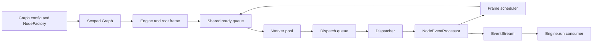

<!-- knowledge
last_checked: "2026-10-29T01:02:46Z"
-->
# Architecture

This navigation map describes the current implementation, not historical design
decisions.
Contributor commands and contribution rules live in [CONTRIBUTING.md](CONTRIBUTING.md).

## Public entry points

Graphon is an embeddable Python workflow engine. The host application supplies
workflow configuration, inputs, integration adapters, and any persistence.
The top-level `graphon` package does not re-export its primary classes; import
them from the packages below.

| Surface | Entry point | Evidence |
| --- | --- | --- |
| YAML import and inspection | `graphon.dsl.inspect`, `graphon.dsl.loads` | [Importer](src/graphon/dsl/importer.py), [DSL tests](tests/dsl/) |
| Graph construction | `graphon.graph.Graph`, `GraphBuilder`, `NodeFactory` | [Graph implementation](src/graphon/graph/graph.py), [graph tests](tests/graph/test_graph.py) |
| Execution | `graphon.engine.Engine` | [Engine](src/graphon/engine/engine.py), [workflow tests](tests/workflows/test_full_engine_events.py) |
| Execution setup and state | `graphon.runtime.RuntimeState`, `VariablePool`, `InitParams` | [Runtime exports](src/graphon/runtime/__init__.py), [runtime tests](tests/runtime/) |
| Integration contracts | `graphon.protocols` | [Protocol exports](src/graphon/protocols/__init__.py), [export tests](tests/test_protocols_exports.py) |

The [Python example](examples/slim_llm/code.py) constructs nodes and an engine
directly. The [DSL example](examples/slim_llm/dsl.py) uses `loads()`, which builds
the variable pool, runtime state, node factory, graph, and engine. Built-in node
availability and default DSL support are separate concerns: inspect the
[DSL factory](src/graphon/dsl/node_factory.py) for its supported node types.

## Import boundaries

The [Import Linter configuration](pyproject.toml) is the source of truth for
allowed package dependencies. [Layer regression tests](tests/test_import_layers.py)
exercise enforcement in CI.

The execution model shares graph/node schemas and
[container state](src/graphon/runtime/container_state.py);
[legacy snapshot migration](src/graphon/runtime/runtime_state/v2.py) uses graph
scoping, and [condition utilities](src/graphon/utils/condition/processor.py)
consume runtime interfaces. The public facade sits above this layer because it
re-exports `NodeFactory` and consumer contracts. These layers permit imports of
concrete node implementations from the facade; fresh-process tests below enforce
its node-registration guarantee.

Import isolation and lazy registration are enforced by
[runtime import tests](tests/runtime/test_runtime_imports.py) and
[public-contract import tests](tests/test_protocols_exports.py). Use the public
runtime paths for new integrations; engine queue aliases exist for compatibility.

## Execution flow

1. [Graph.init](src/graphon/graph/graph.py) turns input configuration into a
   scoped executable graph. `Graph.new()` supplies the builder for directly
   instantiated nodes; see the [Python example](examples/slim_llm/code.py).
2. [Engine](src/graphon/engine/engine.py) binds a root frame, command processor,
   event stream, fixed worker pool, and dispatcher. Calling `run()` starts or
   resumes execution and yields graph and frame lifecycle events, committed
   variable observations, and processed node and traversal events.
3. [Scheduler](src/graphon/engine/scheduler.py) queues frame-qualified `StartTask`
   values. [Workers](src/graphon/engine/worker/worker.py) bind execution IDs,
   execute node generators inside [layer task contexts](src/graphon/engine/layer/README.md),
   and queue results.
4. [Node.run](src/graphon/nodes/base/node.py) wraps `_run()`, emits the start event,
   converts node payloads into engine events, and converts execution exceptions
   into failed-node events. Node implementations live in [nodes](src/graphon/nodes/).
5. [Dispatcher](src/graphon/engine/dispatcher.py) serializes result processing,
   external commands, and completion detection. Its
   [event processor](src/graphon/engine/event/processor.py) stores outputs,
   applies failure/retry policies, updates scheduling, and publishes events.
6. [EventStream](src/graphon/engine/event/stream.py) buffers events for the caller
   and notifies layers. `Engine.run()` emits terminal status and stops execution
   resources. A failed graph emits `GraphRunFailedEvent` and raises its error.

Response presentation is a consumer concern. `Engine.run()` yields raw engine
events; hosts use [filter_engine_events](src/graphon/engine/filter/chain.py) with
[ResponseStreamFilter](src/graphon/engine/filter/builtin/response_stream/filter.py)
for response selection, template assembly, buffering, and presentation order.
Producer chunks remain immediate, including across parallel container items.
See [raw-event tests](tests/engine/test_raw_engine_events.py) and
[filter tests](tests/engine/test_event_filters.py).

## Raw frame observations

[Frame events](src/graphon/engine_events/frame.py) expose execution state for
consumers that may read events after a child frame has been removed:

| Event | Meaning |
| --- | --- |
| `FrameStartedEvent` | A detached, typed variable baseline and reserved node execution IDs, published after setup and before body scheduling. Child frames also identify their parent and owning container invocation. |
| `FrameVariablesUpdatedEvent` | Detached replacements at the written selectors, published after successful commits. Empty and `None` values are retained; partial failures report only writes that succeeded. |
| `FrameFinishedEvent` | The frame has emitted its last node, traversal, and variable observations, with a succeeded, failed, or aborted outcome. Child completion is published before registry removal. |

[FrameRegistry](src/graphon/engine/frame.py) publishes commits for node outputs
and handled-failure defaults, variable requests, Loop initialization, Loop and
Iteration ancestor write-back, and external commands. Every frame sharing an
updated pool receives the observation; private Iteration writes do not produce
ancestor commits. Output commits precede dependent traversal; existing node
request/result events remain available and must not be applied again when
maintaining a view from commit events.

[NodeEvent](src/graphon/engine_events/base.py) carries `frame_id` and
`retry_index`; `id` remains the reserved execution ID across retries.
`NodeRunRetryEvent.retry_index` identifies the next attempt.
[EngineEventFilterContext.from_engine](src/graphon/engine/filter/protocol.py)
sets `run_id` to the persisted root entry execution ID, so it survives
pause/restore and distinguishes separate runs with the same `workflow_id`.

Pause leaves unfinished frames open. Resume publishes new baselines with the
resumption reason and existing execution IDs before resumed body events.
[Persisted container state](src/graphon/runtime/container_state.py) preserves
pending frame failures across pause and snapshot restore. Terminal failure or
abort closes each remaining frame once, before the graph's terminal event.
An `Exception` thrown into `Engine.run()` during execution or at the paused event
follows the same failure ordering; continued consumption re-raises the exception.

Root has no owning invocation. Custom containers may omit optional item index
and root metadata. See the
[frame observation tests](tests/engine/test_frame_observations.py) for baselines,
commits, detached values, and raw chunk delivery, and the
[frame failure tests](tests/engine/test_frame_failures.py) for pause/restore and
consumer exceptions.

Baselines and commits contain full variable values. `ResponseStreamFilter`
suppresses those events from its output; this compatibility guard does not add
child response assembly. Response buffers and presentation state remain in the
filter, separate from runtime snapshots.

## State and execution invariants

Execution state is owned by frames; shared queues and workflow execution connect
those frames without requiring nested worker pools. File adapters are host
resources owned by the engine, while snapshots contain portable state. These
boundaries let the host rebuild an execution with its own integrations.

[Variable pools](src/graphon/runtime/variable_pool.py) preserve node ownership through copies and serialization for both configured graphs and `Graph.new()` graphs.
Iteration writes host variables already present in the parent pool back to that parent, while keeping inherited node variables private to each round.
Independent workflows with fresh pools have separate ownership even when ancestor or sibling graphs reuse the same node IDs.

The executable contracts below are authoritative for validation, lifecycle, and
compatibility details:

| Concern | Implementation | CI evidence |
| --- | --- | --- |
| Frame state and queue ownership | [Frame](src/graphon/engine/frame.py), [runtime state](src/graphon/runtime/runtime_state/state.py) | [Dispatch](tests/engine/test_dispatch_patterns.py) |
| File adapter binding and isolation | [File runtime](src/graphon/file/runtime.py), [engine](src/graphon/engine/engine.py) | [Execution file isolation](tests/engine/test_file_runtime.py), [file scopes](tests/file/test_runtime.py) |
| Container ownership and factory preflight | [Graph and NodeFactory](src/graphon/graph/graph.py), [scoping](src/graphon/graph/scoping.py), [validation](src/graphon/graph/validation.py) | [Graph scoping and validation](tests/graph/test_graph_scoping.py) |
| Branch joins and readiness | [Scheduler](src/graphon/engine/scheduler.py) | [Scheduling](tests/engine/test_scheduler.py) |
| Container suspension and variable propagation | [Container effects](src/graphon/nodes/container_effects.py), [handlers](src/graphon/engine/container_handler/builtin/) | [Cooperative execution](tests/engine/test_cooperative_container_execution.py), [container variable scoping](tests/workflows/test_full_engine_events.py), [Iteration variable ownership](tests/engine/test_iteration_variable_scopes.py) |
| Pause, resume, and snapshot quiescence | [Dispatcher](src/graphon/engine/dispatcher.py), [execution guard](src/graphon/runtime/execution.py) | [Serialization](tests/engine/test_runtime_state_serialization.py) |
| Snapshot versions and migrations | [Snapshot loading](src/graphon/runtime/runtime_state/snapshot.py) | [Runtime snapshots](tests/runtime/test_runtime_state.py), [version isolation](tests/test_snapshot_version_isolation.py) |

For host rendering, bind the engine's adapter with
[use_workflow_file_runtime](src/graphon/file/runtime.py); use
[EngineEventFilterContext.from_engine](src/graphon/engine/filter/protocol.py) to
wire response filters. Supply host adapters again when rebuilding from snapshots.

Persist after fully consuming the run iterator or from a quiescent `on_graph_end`
hook. Hosts must also coordinate direct mutation of exposed runtime objects: the
snapshot guard tracks engine activity, so it cannot protect arbitrary host writes.

## Extension seams

| Change | Start here | Existing check |
| --- | --- | --- |
| Add a node | [Node base class](src/graphon/nodes/base/node.py), [NodeFactory](src/graphon/graph/graph.py); import the subclass to register its type/version | [Node execution binding](tests/nodes/base/test_node_execution_binding.py), [factory tests](tests/dsl/test_node_factory.py) |
| Add lifecycle observation or limits | [Layer API and usage](src/graphon/engine/layer/README.md); runtime access is read-only, controls use commands | [Layer context tests](tests/engine/test_layer_node_run_context.py) |
| Pause, abort, or update variables externally | [Command API and channels](src/graphon/engine/command/README.md) | [Dispatch tests](tests/engine/test_dispatch_patterns.py) |
| Adapt the consumer event stream | [Filter protocol](src/graphon/engine/filter/protocol.py) | [Filter tests](tests/engine/test_event_filters.py) |
| Add a container kind | [ContainerHandler](src/graphon/engine/container_handler/protocol.py), `Engine(container_handler_factories=...)`, [persisted container state](src/graphon/runtime/container_state.py) | [Custom-container tests](tests/runtime/test_custom_container_state.py), [tool-workflow variable scoping](tests/engine/test_dispatch_patterns.py) |
| Replace model, code, HTTP, file, or tool integration | [Public protocols](src/graphon/protocols/__init__.py), concrete node constructors, [DSL adapters](src/graphon/dsl/) | [Protocol exports](tests/test_protocols_exports.py), matching node/adapter tests |

Use the [host integration guide](docs/development.md#integrate-host-services)
for adapter selection and [tracked LLM API debt](docs/technical-debt.md#td-06--ignored-llm-integration-arguments)
for compatibility arguments that have no effect.
