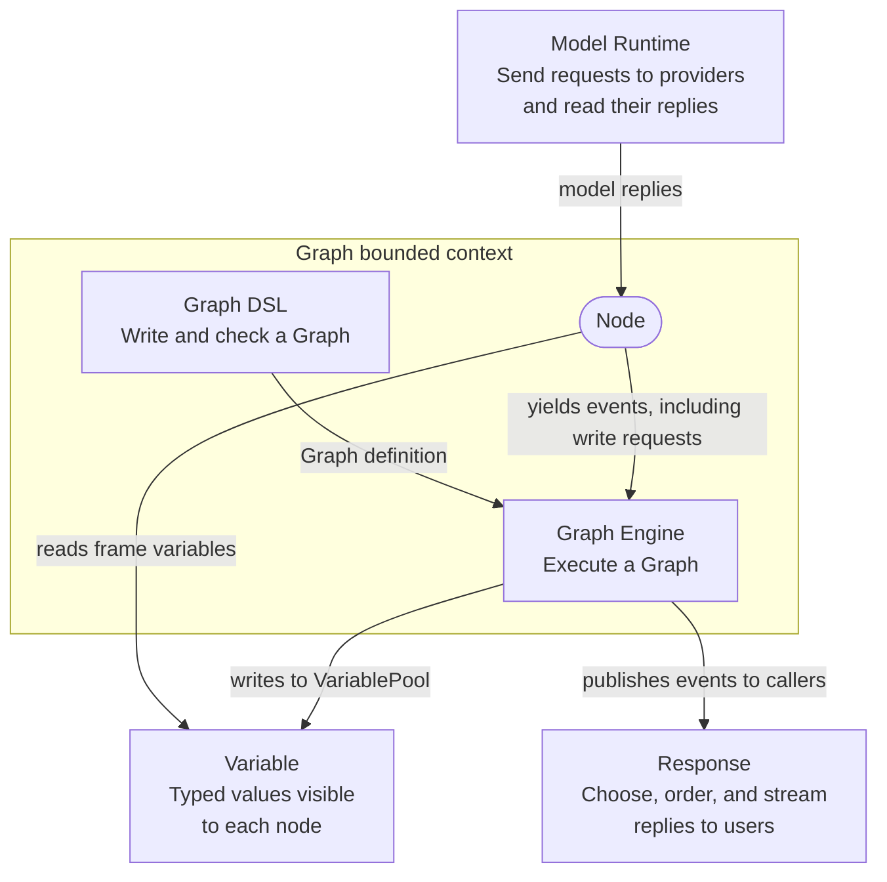
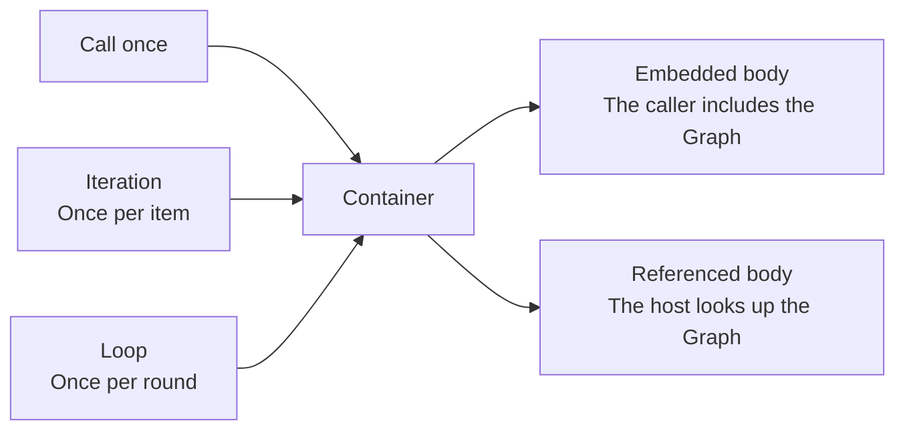

<!-- knowledge
last_checked: "2026-11-27T06:38:54Z"
-->
# Graph domain model

Graphon's design has five **subdomains**, each with a different job. Graph DSL
and Graph Engine share the **Graph bounded context**. Within it, a node means
a step, its type says what it does, and an edge is a possible path between
steps. Both use the same Graph definition and rules for calling it.

Every node reports what happens as it runs by yielding events to the Graph
Engine. The engine defines those events and uses them to update execution state,
decide whether to retry a failed node, and schedule nodes as they become ready.
Response interprets the events the engine exposes to callers and assembles the
reply users see. See [Execution flow](../ARCHITECTURE.md#execution-flow) and
[Response sessions](../ARCHITECTURE.md#response-sessions).

Nodes in a frame share a read-only view of its variable pool. Each read returns
a copy of the current value. A node yields `VariableUpdatedEvent` to write a
variable or supplies named outputs in its result. The engine copies these
values when it receives them and commits the writes in dispatch order.
See the [frame observation tests](../tests/engine/test_frame_observations.py).

## Definition and execution

A `Graph` is an immutable **value object**, whether read from YAML or built in
Python. It defines where execution can start, each node's type, version and
settings, and the Graph a node can call.
Edges connect nodes within the same Graph. Two definitions are equal when this
content matches, including node and edge IDs and the order of each node's
outgoing edges.

The Graph Engine creates a `FrameGraph` for the root and another each time a
container calls its body. Each holds the selected entry, executable nodes and
the traversal state of each edge.

`GraphExecution` is the **aggregate root** for one run. It controls when the
run can start, pause or finish. Two runs of the same Graph can choose different
entries. Each keeps its own variables, branch decisions, active calls, loop
progress and outputs. An Iteration body can read its current item as a Variable.

## Calling a Graph

A `Container` calls a Graph with inputs and returns its outputs, like a
function. The calling node determines how often the body runs.

Iteration and Loop accept either form. An Iteration over a list of names can
call the same greeting Graph once per name, whether the caller embeds the body
or references it by ID and optional version. Node and edge IDs are local to
each Graph, so two bodies can use the same IDs.
[Graph definition and execution tests](../tests/graph/test_graph_definition.py)
